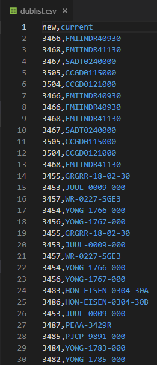

# DubScript

## Backstory

_Written in 2025, 6 years after I wrote this script._

I created this script when I worked at a radio station. We would get syndicated
shows via FTP that were stored as .mp3 files in an annoyingly-deep folder tree,
and our radio automation system (WireReady) expected .wav files, not .mp3.

On a weekly basis some poor soul had to do the work of reading the "dublist" to
figure out which files we needed, moving those files out of the FTP server,
rename them to something useful, and convert them. This had to be done for every
syndicated show we subscribed to, and of course it was done by hand.

I had been dabbling in bash through personal projects off-and-on for close to 5
years at this point, and I saw this as a good opportunity to pick up PowerShell.

This script was my first real entry into automation. I would do it very
differently today, but it is an interesting look back in time.

---

## Behavior

Dubscript Automatically moves files from the dump folder to the production
folder, renames, and converts them from .mp3 to .wav.

Note that the dublist often calls for naming multiple unique files from the dump
folder to the _same_ name in the production folder, resulting in DubScript
overwriting the file multiple times. This is generally okay. See
[Logging](#logging) if you encounter a missing spot and need to fix it.

## Requirements

1. Download [FFmpeg](https://ffmpeg.zeranoe.com/builds/) for file conversion.

2. Update your PATH environment variable to include the path to ffmpeg\bin (e.g.
   C:\Program Files\ffmpeg\bin)

## Setup dublist.csv

1. Convert the weekly dublist.pdf to .xlsx one way or another.
   [This](https://www.pdftoexcel.com) is a good site to use.

2. Remove all text that isn't in the `Media #` or `ISCI` columns, including the
   column headers.

3. Create new column headers. In cell **1A**, enter `new`. In cell **1B**, enter
   `current`.

4. Cut all `Media #` and `ISCI` entries and paste them under the `new` and
   `current` headers you just made.

5. Save the file as `DubScript\dublist\dublist.csv`

6. I prefer to do this step in VS Code. Remove all characters from the `new`
   column that aren't going to be part of the filename (I.E., remove all
   occurrances of "NET" so the entries under `new` are only numbers). Remove all
   extraneous commas. Save the file again. Refer to the example below for what
   the final product should look like.

7. Edit DubScript.ps1 to make sure `$csv` (dublist.csv), `$original_path` (dump
   folder), and `$destination_path` (production folder) are pointing to the
   right places.

## Execution

Right click DubScript.ps1 > Run with PowerShell

## Logging

Logging is powered by the Write-Log.ps1 cmdlet. Write-Log.ps1 has to be in the
same folder as DubScript.ps1 in order for it to work.

As of right now, logging is pretty basic. It only really exists to prove that
`originalfile.mp3` was moved to the production folder and converted to
`newfile.wav` on the off chance someone asks.

The log will show you what files get overwritten since multiple files often want
the same name, so if there is a missing spot somewhere, you can see if it was
overwritten. and fix it manually if necessary.

## Testing

DubScript will take the `oldname.mp3` files from `test\Dump` and copy them to
the `test\Production` as `newname.wav`. Delete all contents of the
`test\Production` folder for each test.

## Future Plans

- Automate the conversion of .pdf to .csv and as much formatting as possible.

- Logging for fail states. Right now it only logs expected behavior.

- Prompt for paths instead of hard-coding them.

- GUI?
